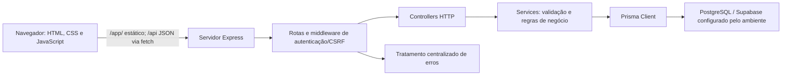
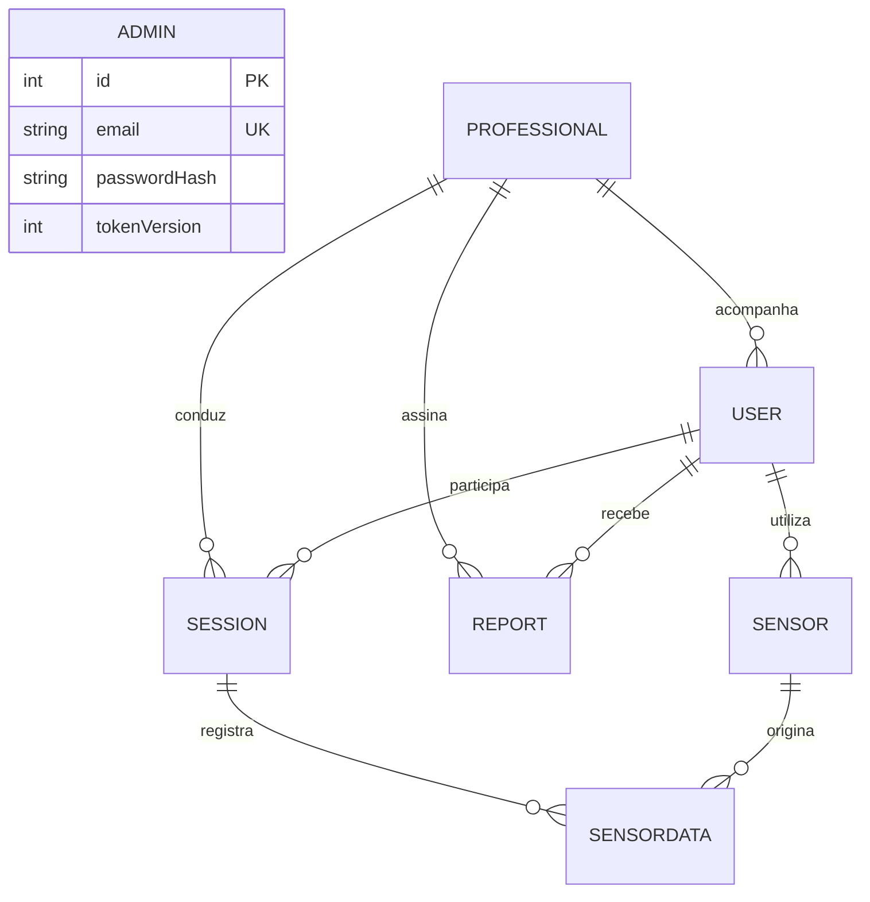
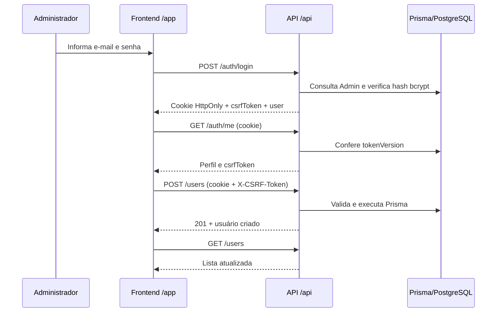

# Diagramas — Vital Experience, Fase 02

## Arquitetura implementada

O código do navegador fica em `frontend/` e é servido por `backend/server.js` em `/app`. A camada `frontend/js/api.js` converte campos e rótulos da interface para o contrato da API. O Express responde em `/api`, separa rotas, controllers e services, e utiliza o Prisma Client para acesso aos dados. A conexão com PostgreSQL depende das URLs externas; a execução desta fase não incluiu banco de teste.

## Modelo de dados

`Professional` e `Sensor` podem estar ausentes em relações opcionais; a configuração de exclusão dessas relações usa `SET NULL` quando aplicável. As migrations Prisma governam o esquema. A coluna `Admin.tokenVersion` foi acrescentada na Fase 02 para invalidar sessões anteriores após a troca de senha.

## Fluxo do navegador

O fluxo HTTP do cliente foi exercitado em teste local com delegates Prisma substituídos por memória. As setas para PostgreSQL representam a implementação prevista pelo código, não uma conexão real verificada neste ambiente.

## Fluxo de monitoramento

1. Cadastrar usuário e, opcionalmente, profissional.
2. Abrir sessão para usuário ativo, informando tipo e início.
3. Registrar uma leitura sintética manual de demonstração ou enviar leitura válida à API; o serviço verifica sessão e sensor vinculado, se informado.
4. Finalizar sessão com horário final não anterior ao inicial.
5. Consultar sessões, leituras e agregações em `/reports/user/:userId`.

Não há comunicação com hardware, WebSocket ou alertas automáticos implementados.
